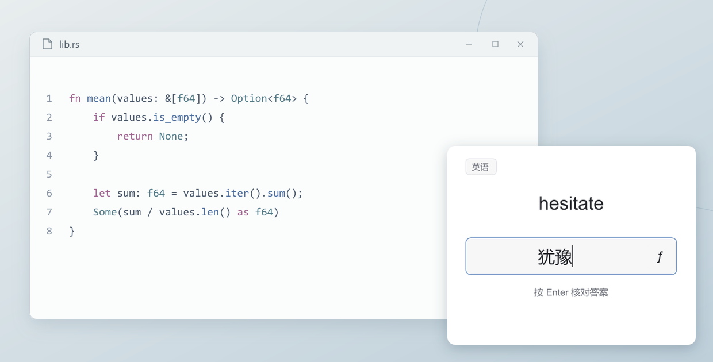
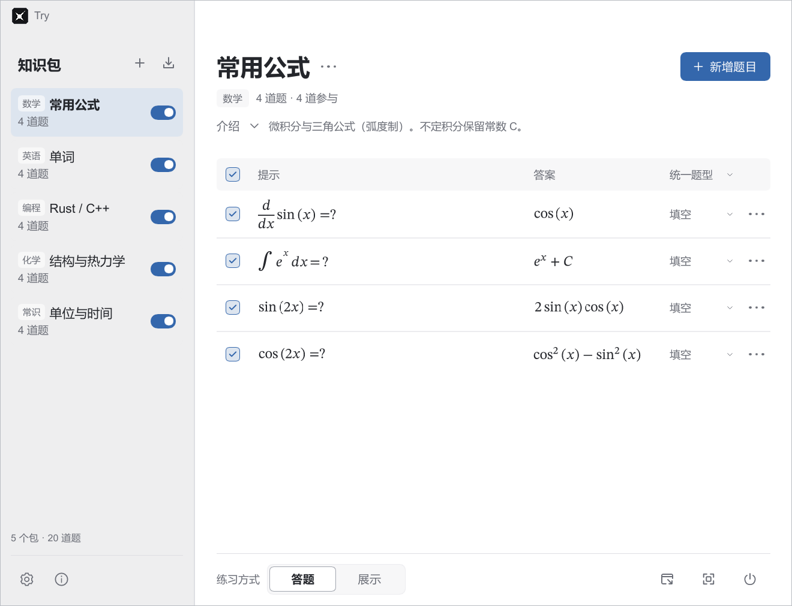

<h1> Try</h1>

[English](readme_en.md) · 简体中文

**A little practice, now and then.**

Try 是一款轻量、开源的桌面闪卡工具。它常驻系统托盘，按你设定的间隔在桌面角落弹出一道题。把总要查的公式、词义或代码写法放进自己的题库，在用电脑的间隙练出「看到提示就想到答案」的肌肉记忆。

你可以在卡片上填空、选择或判断，也可以切换到「展示」直接看答案。答题时先出未答过的题，再根据对错和距上次作答的时间安排间隔复习。练习可以离线进行，题库和练习记录保存在本机。

*Open-source desktop flashcards for active recall and spaced repetition. Try runs in the system tray and shows one card at a time from your own decks.*

[观看一次完整作答](docs/images/practice_demo.gif) · Windows 版卡片已隐藏操作提示，桌面为示意。

## 下载

在 [最新正式版](https://github.com/Ethan-decoy/Try/releases/latest) 的附件中下载对应平台的程序。

| 平台 | 下载文件 | 状态 |
| --- | --- | --- |
| Windows x64 | [try.exe](https://github.com/Ethan-decoy/Try/releases/latest/download/try.exe) | 单文件便携版 |
| macOS arm64 | `try_macos_arm64_<版本>.zip` | 实验性，尚未公证 |
| Linux x64 | `try_linux_x64_<版本>.AppImage` | 实验性 |

Windows 将 `try.exe` 放在可写文件夹中双击运行。题库、设置和练习记录存放在旁边的 `data/` 中，移动程序时请一起保留。后续正式版可在「关于」中下载并重启更新。

正式版的兼容支持从 1.0.0 开始。从 0.x 预发布版升级前，请备份数据目录。Try 会沿用仍可读取的旧数据。

首次运行已有示例题。在主窗口点「回到托盘」即可开始提醒计时，想马上试一题可左键点击托盘图标。macOS 从菜单栏的 Try 图标选择「练习」。希望卡片弹出后仍能在原窗口打字，可关闭「弹出时自动聚焦」。详见[使用说明](docs/user_guide.md)。

## 选择想练习的内容

自带的知识包里有 `hesitate` → 犹豫，也有「Rust 可变引用」→ `&mut T`。在主窗口勾选想练的题目，点击题面即可编辑。题面可以配图，公式题可以直接输入常用的 LaTeX 写法。

## 让 AI 制作知识包

1. 将 [AI 制作模板](docs/knowledge_pack_ai_template.md) 的全文交给 AI，并说明想练习的主题、知识包名称、标签和题目数量。
2. 让 AI 只输出合法 JSON，将结果保存为 UTF-8 的 `.json` 文件。
3. 在 Try 主窗口导入该文件，即可开始练习。

例如：

> 按模板生成 20 道微积分必要公式填空题，名称“微积分”，标签“公式”。保留必要条件，每题只保留短提示与明确答案，只输出 JSON。

也可以先导入 [微积分公式](knowledge_packs/authoring_template.json)、[高阶英语词汇](knowledge_packs/vocabulary_template.json) 或 [Rust 常用写法](knowledge_packs/rust_template.json)，每份 12 题。字段说明见 [知识包格式](docs/knowledge_pack_format.md)。

## 反馈

问题与建议请提交到 [Issues](https://github.com/Ethan-decoy/Try/issues)。

## 许可

Try 自有代码与 Logo 采用 [MIT](license)，第三方组件遵循各自许可，见 [第三方声明](docs/third_party_notices.md)。

<a href="https://slint.dev">
  <picture>
    <source media="(prefers-color-scheme: dark)" srcset="https://raw.githubusercontent.com/slint-ui/slint/v1.18.1/logo/MadeWithSlint-logo-dark.svg" />
    <source media="(prefers-color-scheme: light)" srcset="https://raw.githubusercontent.com/slint-ui/slint/v1.18.1/logo/MadeWithSlint-logo-light.svg" />
    
  </picture>
</a>
