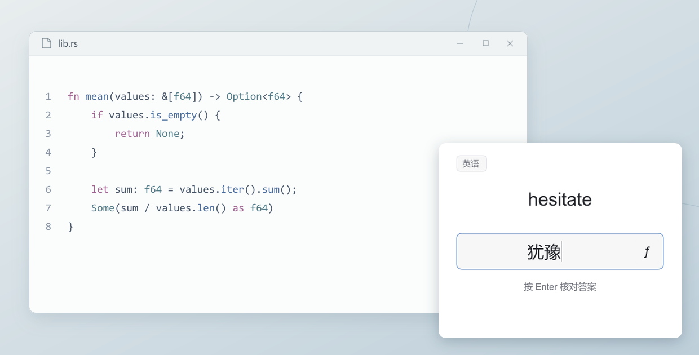
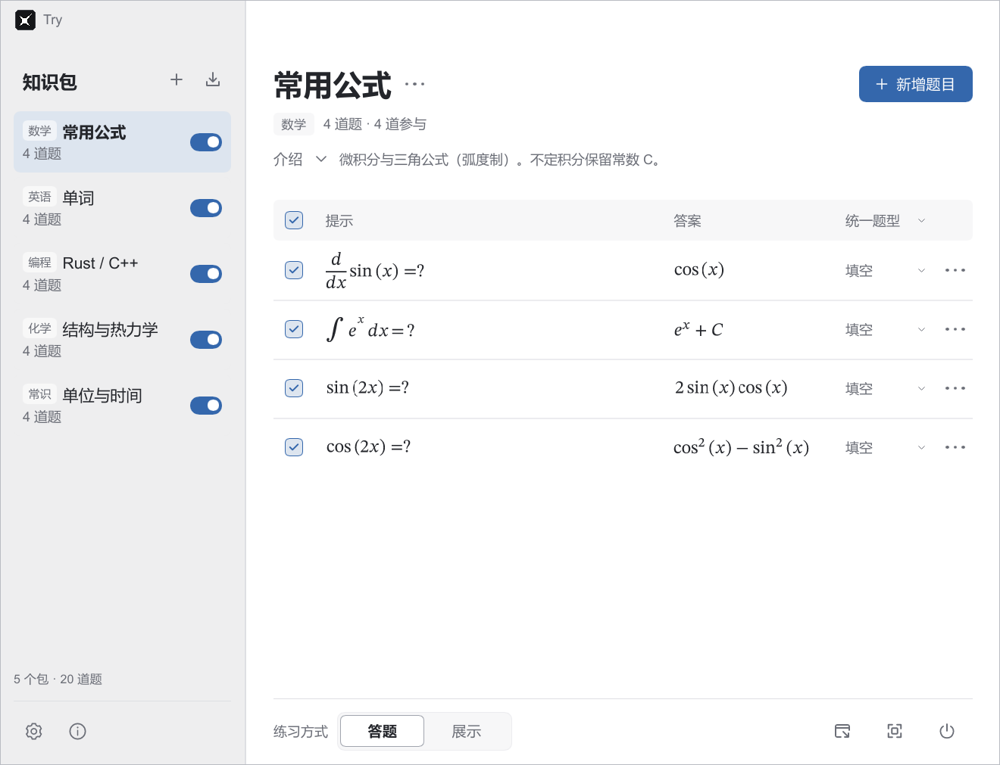

<h1> Try</h1>

English · [简体中文](README.md)

**A little practice, now and then.**

Try is a lightweight, open-source desktop flashcard app that runs in the system tray. At intervals you choose, a question pops up in a corner of your screen. Make a deck of formulas, words or bits of code you keep looking up, and practice recalling them while you work.

For active recall, type an answer, pick an option or mark a statement true or false. Try starts with unanswered questions, then uses spaced repetition based on your results and the time since you last answered each question. Switch to **View** to see the answers directly. You can practice offline, and your decks and review history stay on your computer.

[Watch one question from start to finish](docs/images/practice_demo.gif) · A Windows card with hints hidden, shown against an illustrative desktop.

## Download

Download the app for your platform from the [v1.0.0 stable release](https://github.com/Ethan-decoy/Try/releases/tag/v1.0.0).

| Platform | Download | Status |
| --- | --- | --- |
| Windows x64 | [try.exe](https://github.com/Ethan-decoy/Try/releases/download/v1.0.0/try.exe) | Single-file portable app |
| macOS arm64 | [try_macos_arm64_1.0.0.zip](https://github.com/Ethan-decoy/Try/releases/download/v1.0.0/try_macos_arm64_1.0.0.zip) | Experimental, not notarized |
| Linux x64 | [try_linux_x64_1.0.0.AppImage](https://github.com/Ethan-decoy/Try/releases/download/v1.0.0/try_linux_x64_1.0.0.AppImage) | Experimental |

On Windows, put `try.exe` in a writable folder and open it. Your decks, settings and review history live in the adjacent `data/` folder. Keep it with the executable when moving the app. To install a newer stable release, choose **Update & restart** in About.

Compatibility starts with 1.0.0. If you are upgrading from a 0.x preview, back up your data folder first. Try reuses any data it can read.

Sample decks are ready on first launch. Choose **Back to tray** in the main window to start the reminder timer. To see a card right away, left-click the tray icon on Windows or Linux, or choose **Practice** from the Try menu in the macOS menu bar. To keep typing in your current window when a card appears, turn off **Automatically focus new cards** in Settings. See the [user guide](docs/user_guide_en.md) for details.

## Choose what to practice

The starter decks include a vocabulary card pairing *hesitate* with 犹豫 and a Rust card asking how to write a mutable reference (`&mut T`). Select the questions you want to practice in the main window, or click a prompt to edit it. Prompts can include images, and formula answers accept common LaTeX expressions.

## Create knowledge packs with AI

1. Give an AI the full [authoring template](docs/knowledge_pack_ai_template.md), along with your topic, pack name, tag and question count.
2. Ask it to output only valid JSON, then save the result as a UTF-8 `.json` file.
3. Import the file in Try's main window and start practicing.

For example:

> Follow the template to create 20 short-answer questions on essential calculus formulas. Use “Calculus” as the name and “Formulas” as the tag. Include necessary conditions, keep each cue and answer brief, and output only JSON.

You can also import [calculus formulas](knowledge_packs/authoring_template.json), [advanced English vocabulary](knowledge_packs/vocabulary_template.json) or [common Rust APIs](knowledge_packs/rust_template.json), with 12 questions each. These samples use Chinese content. See the [pack format](docs/knowledge_pack_format.md) for field details.

## Feedback

Report problems or suggest improvements through [Issues](https://github.com/Ethan-decoy/Try/issues).

## License

Try's own code and logo use [MIT](license). Third-party components retain their own licenses; see [notices](docs/third_party_notices.md).

<a href="https://slint.dev">
  <picture>
    <source media="(prefers-color-scheme: dark)" srcset="https://raw.githubusercontent.com/slint-ui/slint/v1.18.1/logo/MadeWithSlint-logo-dark.svg" />
    <source media="(prefers-color-scheme: light)" srcset="https://raw.githubusercontent.com/slint-ui/slint/v1.18.1/logo/MadeWithSlint-logo-light.svg" />
    
  </picture>
</a>
