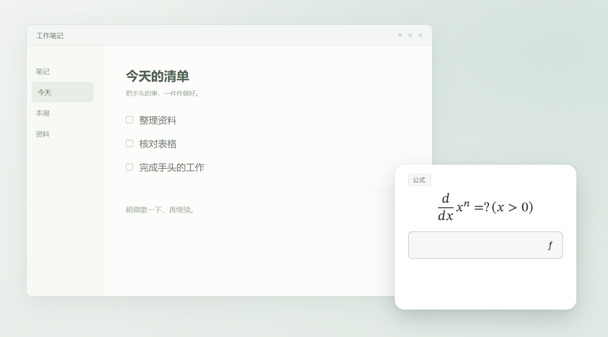

<h1> Try</h1>

English · [简体中文](README.md)

**A little practice, now and then.**

Try is a lightweight desktop practice tool for revisiting formulas, vocabulary and other knowledge during breaks between work and play.

At your chosen interval, answer one short question or glance at a knowledge card, then return to what you were doing. Typed answers, multiple choice and true/false are supported.

*Actual Try v0.6.0 practice card on Windows, enlarged in an illustrative desktop layout.*

## Download

Download the file for your platform from the [latest version (v0.7.2 prerelease)](https://github.com/Ethan-decoy/Try/releases/tag/v0.7.2).

| Platform | Download | Status |
| --- | --- | --- |
| Windows x64 | [try.exe](https://github.com/Ethan-decoy/Try/releases/download/v0.7.2/try.exe) | Portable |
| macOS arm64 | [try_macos_arm64_0.7.2.zip](https://github.com/Ethan-decoy/Try/releases/download/v0.7.2/try_macos_arm64_0.7.2.zip) | Experimental |
| Linux x64 | [try_linux_x64_0.7.2.AppImage](https://github.com/Ethan-decoy/Try/releases/download/v0.7.2/try_linux_x64_0.7.2.AppImage) | Experimental |

On Windows, put `try.exe` in a writable folder and open it. Closing the main window returns to the tray. First launch creates an adjacent `data/` folder; keep it with the executable. Choose Update & restart in About to download, verify, install and restart automatically. Versions `0.2.1` and earlier need one manual upgrade first.

The macOS version supports arm64 only. macOS/Linux versions are experimental, and macOS packages are not notarized. See the [user guide](docs/user_guide_en.md) for detailed controls.

## Choose what to practice

Manage knowledge packs and choose which questions to practice. Click a prompt to edit it, with support for formulas and images.

*Try v0.6.0 on Windows, using public sample knowledge packs.*

## Create knowledge packs with AI

1. Give an AI the full [authoring template](docs/knowledge_pack_ai_template.md), along with your topic, pack name, tag and question count.
2. Ask it to output only valid JSON, then save the result as a UTF-8 `.json` file.
3. Import the file in Try's main window and start practicing.

For example:

> Follow the template to create 20 short-answer questions on essential calculus formulas. Use “Calculus” as the name and “Formulas” as the tag. Include necessary conditions, keep each cue and answer brief, and output only JSON.

You can also import [calculus formulas](knowledge_packs/authoring_template.json), [advanced English vocabulary](knowledge_packs/vocabulary_template.json) or [common Rust APIs](knowledge_packs/rust_template.json), with 12 questions each. These samples use Chinese content. See the [pack format](docs/knowledge_pack_format.md) for field details.

## Feedback

Report problems or suggest improvements through [Issues](https://github.com/Ethan-decoy/Try/issues).

## License

Try's own code and logo use [MIT](license). Third-party components retain their own licenses; see [notices](docs/third_party_notices.md).

<a href="https://slint.dev">
  <picture>
    <source media="(prefers-color-scheme: dark)" srcset="https://raw.githubusercontent.com/slint-ui/slint/v1.18.1/logo/MadeWithSlint-logo-dark.svg" />
    <source media="(prefers-color-scheme: light)" srcset="https://raw.githubusercontent.com/slint-ui/slint/v1.18.1/logo/MadeWithSlint-logo-light.svg" />
    
  </picture>
</a>
